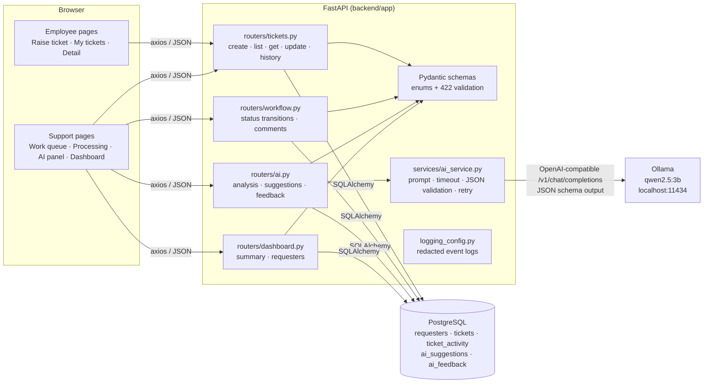
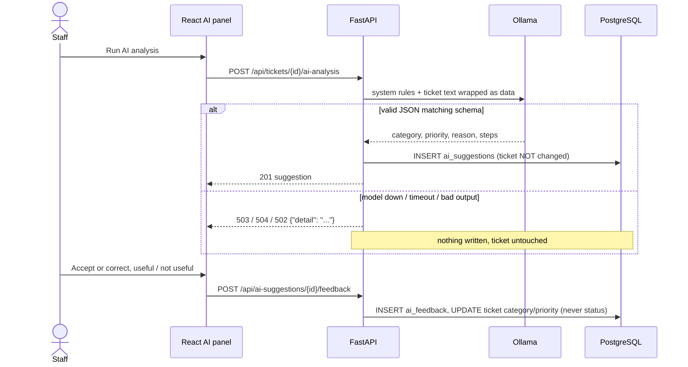

# Architecture

## Human control over the AI

## Key rules

| Rule | Where it is enforced |
|---|---|
| Enums identical everywhere | `schemas/enums.py`, CHECK constraints in `models/`, `frontend/src/constants.js` |
| Status only via allowed transitions (else 409) | `routers/workflow.py` |
| Status cannot be edited via PATCH /tickets/{id} (422) | `TicketUpdate` forbids extra fields |
| AI suggestion stored apart from confirmed values | `ai_suggestions` table; ticket changes only in the feedback endpoint |
| AI failure never touches the ticket | `ai_service.py` writes nothing; router commits only after valid output |
| No ticket text, secrets or connection strings in logs | `logging_config.py` redaction; SQL echo off |
